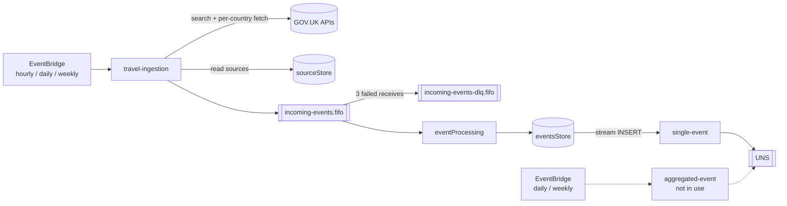

# Architecture

How a change to GOV.UK travel advice becomes a notification in the GOV.UK app.

---

## Overview

| Stage                | Lambda              | Trigger                                | Output                                              |
| -------------------- | ------------------- | -------------------------------------- | --------------------------------------------------- |
| Ingest               | `travel-ingestion`  | EventBridge: hourly, daily, weekly     | One queue message per travel advice change          |
| Persist              | `eventProcessing`   | SQS FIFO, batch size 1                 | One `eventsStore` row per unique change             |
| Instant notification | `single-event`      | `eventsStore` stream, `INSERT` only    | Two UNS payloads (push and message centre)          |
| Digest (not in use)  | `aggregated-event`  | EventBridge: daily, weekly             | One UNS payload per country                         |

Every resource lives in one stack, [`events-aggregator-stack.ts`](/cdk/stacks/events-aggregator-stack.ts), and every resource name is prefixed with `<env>-` (see [resource names](./infrastructure-development.md#resource-names)). Function names don't always match directory names: the code in `src/event-processing/` deploys as `eventProcessing`.

Each Lambda's README has a sample event and a sequence diagram: [`travel-ingestion`](/src/travel-ingestion/README.md), [`event-processing`](/src/event-processing/README.md), [`single-event`](/src/single-event/README.md), [`aggregated-event`](/src/aggregated-event/README.md).

### Glossary

| Term        | Meaning                                                                                       |
| ----------- | --------------------------------------------------------------------------------------------- |
| **Source**  | Something to watch. Today, one GOV.UK travel advice page per country (a `sourceStore` row)    |
| **Event**   | One change to a source, keyed by `namespace/group` (for example, `travel/myanmar`)            |
| **Cadence** | When an event is sent: `instant`, `daily` or `weekly`                                        |
| **Subgroup**| The UNS `Subgroup` field on a payload: `instant`, `none`, `daily` or `weekly`                 |
| **Channel** | The UNS delivery channel: `PUSH_NOTIFICATION_AND_MESSAGE_CENTRE` or `MESSAGE_CENTRE_ONLY`     |

---

## Data model

**`sourceStore`** holds one row per country, written by the [seed script](/scripts/seed-travel-events-source.ts). `travel-ingestion` looks up rows by `compositeKey` (`travel/<slug>`), fetches `URL`, skips rows with `sourceEnabled = false`, and records the newest change it saw in `lastUpdated`.

**`eventsStore`** holds one row per change (`DynamoEvent` in [`src/types/event.ts`](/src/types/event.ts)):

| Attribute          | Notes                                                                             |
| ------------------ | --------------------------------------------------------------------------------- |
| `eventID`          | sha256 of `namespace\|group\|public_timestamp\|note`, so it's the same for every sighting of one change |
| `compositeKey`     | `travel/<slug>`                                                                   |
| `eventTimestamp`   | GOV.UK `public_timestamp`                                                         |
| `eventNote`        | The GOV.UK change note                                                            |
| `processingStatus` | When each cadence sent the event (`instant`, `DAILY`, `WEEKLY`). A missing key means not sent |

---

## Duplicate protection

The hourly, daily and weekly travel runs have overlapping look-back windows, so the same change is seen several times. Three layers make that safe:

1. **SQS FIFO content-based de-duplication** removes identical messages sent within 5 minutes. Messages are grouped by `travel/<slug>`, so each country's changes are processed in order.
2. **The conditional write in `eventProcessing`** (`attribute_not_exists(eventID)`) skips changes that are already stored.
3. **`GroupNotificationID`** on instant payloads is a deterministic UUID (`hashToUuidV4`), so UNS can reject a resend.

See [Idempotency and Deduplication](./idempotency.md) for hash inputs, the reasoning behind using `startTime` rather than `source.lastUpdated`, and how `debugSuffix` bypasses these layers.

---

## Failure semantics

| Lambda              | Retries                                         | After the final retry                                 |
| ------------------- | ----------------------------------------------- | ----------------------------------------------------- |
| `travel-ingestion`  | 2 async retries, maximum event age 2 hours      | Dropped. The next run's look-back window covers the gap |
| `eventProcessing`   | Re-received after 60 s, 3 receives in total     | Moved to `incoming-events-dlq.fifo` (P1 alarm)        |
| `single-event`      | 3 stream retries, bisect on error               | Discarded (no failure destination is configured)      |
| `aggregated-event`  | 2 async retries                                 | Events stay unmarked and are picked up by the next run inside the window |

---

## External integrations

### GOV.UK (inbound)

`travel-ingestion` reads the public, unauthenticated GOV.UK search API (`/api/search.json`, filtered to `travel_advice`) and content API (`/api/content/foreign-travel-advice/<slug>`). The URLs are in [`src/utils/index.ts`](/src/utils/index.ts).

### UNS (outbound)

The Lambdas send with `POST <uns-api-url>/v1/send-to-group` over mutual TLS (mTLS), with an API key. The client is [`src/utils/uns-client.ts`](/src/utils/uns-client.ts).

| Credential                  | Source                                                                         |
| --------------------------- | ------------------------------------------------------------------------------ |
| API URL                     | SSM `/ea-runner/uns-api-url`                                                   |
| Client certificate and key  | Secrets Manager (PEM). The secret ARNs are in SSM `/ea-runner/uns-mtls-cert-arn` and `/ea-runner/uns-mtls-key-arn` |
| KMS key for those secrets   | SSM `/ea-runner/uns-kms-key-arn`                                               |
| API key                     | Secrets Manager `ea-<env>/uns-api-key`                                         |

Lambdas cache SSM values for 60 seconds and secrets for 10 minutes, so a corrected value takes effect within that time without a deploy.

### Flex (cross-account read)

The Flex travel service gateway assumes `FlexTravelReadRole` (account `FLEX_ACCOUNT_ID`, external ID `FLEX_EXTERNAL_ID`) to read both tables. It finds the role ARN and table names in the `<env>-events-aggregator/flex-travel-config` secret, which the Flex account is allowed to decrypt.

---

## Observability

- **Logs:** Powertools JSON logs in `/aws/lambda/<function name>`, kept for 1 week.
- **Traces:** X-Ray on every Lambda, with named subsegments in the scheduled Lambdas.
- **Metrics:** custom metrics in the `EventsAggregator` namespace. Each Lambda README lists its own.
- **Dashboard:** `<env>-events-aggregator-overview`.
- **Alarms:** see [CloudWatch alarms](./infrastructure-development.md#cloudwatch-alarms).

---

## Related

- [Developer Reference](./developer-reference.md)
- [Infrastructure Development Guide](./infrastructure-development.md)
- [Runbooks](./runbooks/README.md)
