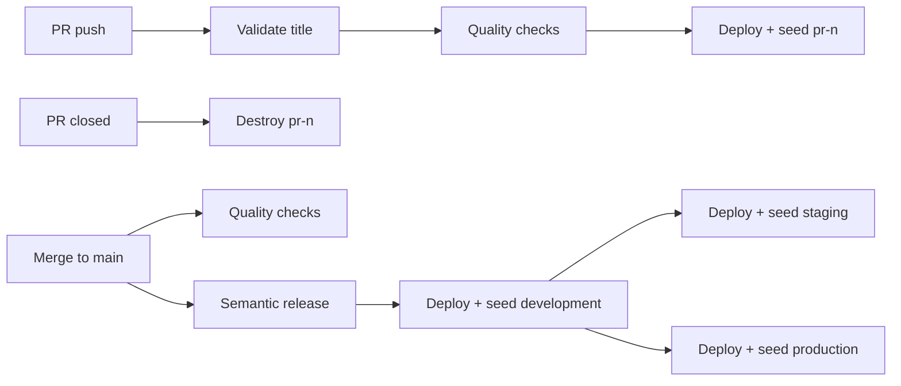

# Deployment Guide

How code reaches each environment, and what to do when a deploy fails.

---

## Environments

| Environment      | `ENVIRONMENT`  | AWS account | Deployed by                       | Slack |
| ---------------- | -------------- | ----------- | --------------------------------- | ----- |
| Personal sandbox | `$USER`        | development | You (`pnpm run cdk:deploy`)       | No    |
| Pull request     | `pr-<n>`       | development | Every push to the PR              | No    |
| Development      | `development`  | development | Every merge to `main`             | Yes   |
| Staging          | `staging`      | staging     | Every merge to `main`, after development | Yes |
| Production       | `prod`         | production  | Every merge to `main`, after development | Yes |

To deploy your own sandbox, see [Environment Setup: personal sandbox](./environment-setup.md#personal-sandbox).

---

## Pipeline

| Workflow                                                              | Trigger                                   | What it does                                                                 |
| --------------------------------------------------------------------- | ----------------------------------------- | ---------------------------------------------------------------------------- |
| [`pull_request.yml`](/.github/workflows/pull_request.yml)             | PR opened or updated                      | Validates the title, runs quality checks, deploys and seeds `pr-<n>`         |
| [`main.yml`](/.github/workflows/main.yml)                             | Push to `main`                            | Quality checks; release, then deploy and seed development, then staging and production in parallel |
| [`_quality_checks.yml`](/.github/workflows/_quality_checks.yml)       | Called by the above                       | Format, lint, types, unit and CDK tests, synth, checkov, SonarQube           |
| [`_build_deploy.yml`](/.github/workflows/_build_deploy.yml)           | Called, or run manually (development, staging, or production) | Seeds SSM parameters, builds, deploys, posts a release message to Slack |
| [`_seed_data.yml`](/.github/workflows/_seed_data.yml)                 | After each deploy                         | Runs the idempotent `sourceStore` seed. A failure only shows a warning       |
| [`ephemeral-cleanup.yml`](/.github/workflows/ephemeral-cleanup.yml)   | PR closed                                 | Destroys `pr-<n>`                                                            |

Each deploy is tagged `Version=<semver>@<sha>` (see [Releases and Versioning](./releases.md)). The workflows use these GitHub Environment settings: `FLEX_ACCOUNT_ID`, `FLEX_EXTERNAL_ID`, `SSM_PARAMETERS_TO_UPDATE`, and the `*_DEPLOYMENT_ROLE` secrets.

To check a deploy afterwards, follow [Verify Environment Health](./runbooks/verify-environment-health.md).

---

## Troubleshooting

| Symptom                                                    | Likely cause and fix                                                                                     |
| ---------------------------------------------------------- | -------------------------------------------------------------------------------------------------------- |
| `Flex Account id and external id not set`                  | `FLEX_ACCOUNT_ID` or `FLEX_EXTERNAL_ID` is missing from the GitHub Environment or your shell              |
| Deploy fails on the UNS secret or KMS references           | `/ea-runner/uns-mtls-*-arn` or `uns-kms-key-arn` still holds a placeholder, so IAM policies reference an invalid ARN. Set the real values through `SSM_PARAMETERS_TO_UPDATE` and re-run |
| Slack channel not created                                  | One of its SSM values is still `*-placeholder`, the stack is a sandbox, or the workspace isn't authorised in Amazon Q Developer. The channel appears on the next deploy after this is fixed |
| `Release notification skipped … no ReleaseNotificationTopicArn` | The deploy didn't complete, or the stack name doesn't match `<env>-events-aggregator-stack`          |
| Seed step shows ⚠️                                         | GOV.UK was unavailable or returned fewer than 150 countries. Re-run the seed job                          |
| PR stack left behind                                       | Re-run its cleanup workflow, or run `aws:sandbox` then `ENVIRONMENT=pr-<n> pnpm run destroy:dev`          |

---

## Related

- [Releases and Versioning](./releases.md)
- [Environment Setup](./environment-setup.md)
- [Fix Forward Runbook](./runbooks/fix-forward.md)
