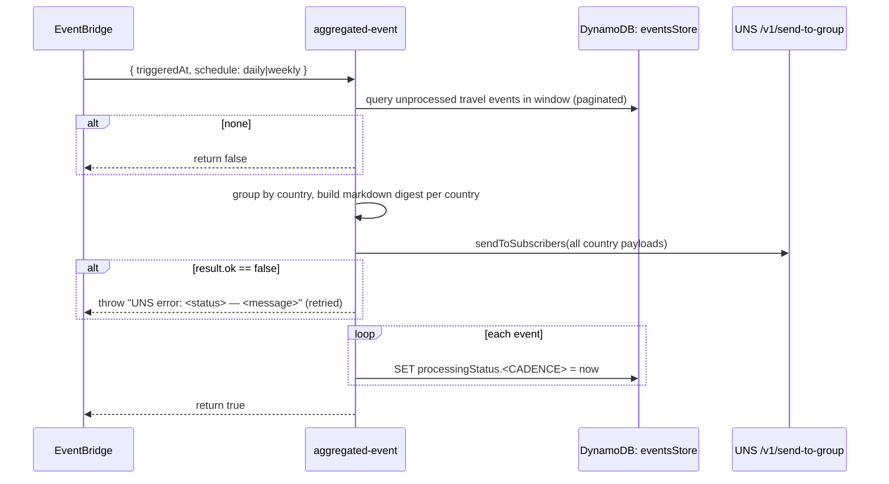

## Aggregated Event (daily and weekly digest)

> The digest feature is not currently in use.

On a daily or weekly schedule, finds travel events not yet included in that cadence's digest, groups them by country, sends one digest message per country to UNS, then marks each event as processed for that cadence.

- **Function:** `<env>-eventsaggregator-aggregated-event`
- **Trigger:** EventBridge rules `DAILYDigestSchedule` and `WEEKLYDigestSchedule`
- **Retries:** see [Architecture: failure semantics](/docs/architecture.md#failure-semantics)

### Sample event

```json
{ "triggeredAt": "2026-10-16T07:00:00Z", "schedule": "daily" }
```

### Infrastructure

- **DynamoDB `eventsStore`:**
  - `Query` on `namespace-timestamp-query` with `namespace = travel`, `eventTimestamp >= now - 1d` (daily) or `now - 7d` (weekly), and a filter of `attribute_not_exists(processingStatus.DAILY|WEEKLY)`.
  - `UpdateItem` per event, setting `processingStatus.DAILY|WEEKLY`.
- **SSM / Secrets Manager:** the same UNS credentials as [`single-event`](../single-event/README.md).
- **UNS:** a single `POST /v1/send-to-group` call carrying one payload per country, with `Subgroup` set to `daily` or `weekly`.
- **Metrics:** `DigestEventsRetrieved`, `DigestCountriesGrouped`, `DigestPayloadsSubmitted`, `DigestSubmissionFailures`, `DigestEventsMarkedProcessed`.

### Logic



### Failure behaviour

- **UNS fails:** nothing is marked, so a retry or the next run resends everything still inside the window.
- **UNS succeeds but marking fails part-way:** the run throws and is retried, so the events left unmarked are sent again.
- **An event older than the window that was never marked** (for example, after more than one full window of outages) is never sent in a digest.

Runbook: [Digest Not Sent](/docs/runbooks/digest-not-sent.md).
