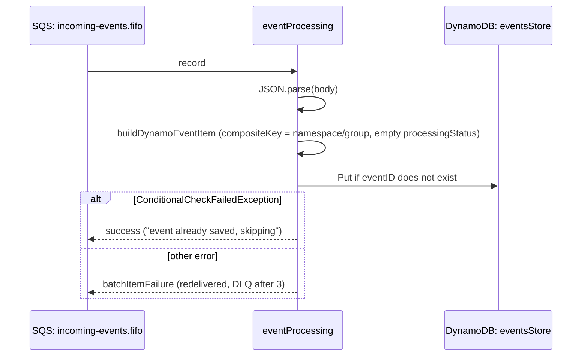

## Event Processing

Consumes `IncomingEvent` messages from the FIFO queue and stores each one in `eventsStore`, at most once per `eventID`.

- **Function:** `<env>-eventsaggregator-eventProcessing`
- **Trigger:** SQS `<env>-sqsevents-incoming-events.fifo`, batch size 1, maximum concurrency 5, partial batch responses
- **Retries:** see [Architecture: failure semantics](/docs/architecture.md#failure-semantics)

### Sample event

```json
{
  "Records": [
    {
      "messageId": "msg-1",
      "body": "{\"eventID\":\"9f2c…\",\"eventTimestamp\":\"2026-08-07T09:14:22.031Z\",\"namespace\":\"travel\",\"group\":\"myanmar\",\"eventNote\":\"Storm warning issued\"}",
      "attributes": { "MessageGroupId": "travel/myanmar", "ApproximateReceiveCount": "1" },
      "eventSource": "aws:sqs"
    }
  ]
}
```

### Infrastructure

- **SQS in:** `incoming-events.fifo`, fed by `travel-ingestion`.
- **DynamoDB `eventsStore`:** `PutCommand` with `ConditionExpression: attribute_not_exists(#eventID)`.
- **Environment:** `TABLE_NAME`.

### Logic



### Failure behaviour

- **Bad JSON:** fails on every attempt and ends up in the DLQ.
- **A duplicate `eventID`:** treated as success. This is the main de-duplication point for overlapping schedules.
- **Any other DynamoDB error:** retried through SQS.

Each successful `Put` produces a stream `INSERT`, which triggers [`single-event`](../single-event/README.md).

Runbooks: [Dead-Letter Queue Not Empty](/docs/runbooks/dead-letter-queue.md), [Queue Backlog](/docs/runbooks/queue-backlog.md).
