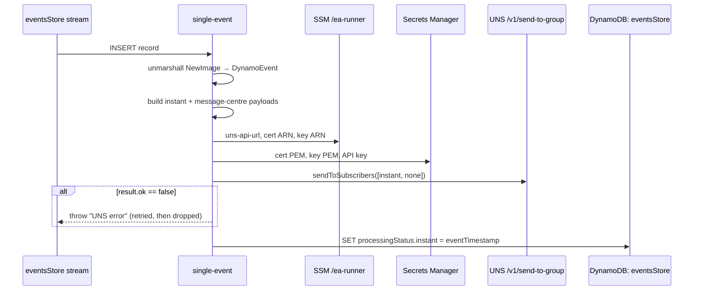

## Single Event (instant notification)

Reacts to each new row in `eventsStore` by sending an instant notification for that travel advice change to UNS, then records `processingStatus.instant`.

- **Function:** `<env>-eventsaggregator-single-event`
- **Trigger:** `eventsStore` DynamoDB stream (`NEW_AND_OLD_IMAGES`, starting position `LATEST`), batch size 10, bisect on error, 3 retries, partial batch responses
- **Retries:** see [Architecture: failure semantics](/docs/architecture.md#failure-semantics)

### Sample event

```json
{
  "Records": [
    {
      "eventName": "INSERT",
      "dynamodb": {
        "NewImage": {
          "eventID": { "S": "9f2c…" },
          "compositeKey": { "S": "travel/myanmar" },
          "eventTimestamp": { "S": "2026-08-07T09:14:22.031Z" },
          "namespace": { "S": "travel" },
          "group": { "S": "myanmar" },
          "eventNote": { "S": "Storm warning issued" },
          "processingStatus": { "M": {} }
        }
      },
      "eventSource": "aws:dynamodb"
    }
  ]
}
```

`MODIFY` and `REMOVE` records are acknowledged and ignored. This matters because this Lambda's own status update produces a `MODIFY`.

### Infrastructure

- **DynamoDB stream in:** `eventsStore`.
- **SSM:** `/ea-runner/uns-api-url`, `uns-mtls-cert-arn`, `uns-mtls-key-arn`.
- **Secrets Manager:** the UNS client certificate and key (PEM), plus `ea-<env>/uns-api-key`.
- **UNS:** `POST /v1/send-to-group` over mTLS with two payloads:
  - `Subgroup: instant` with `PUSH_NOTIFICATION_AND_MESSAGE_CENTRE`
  - `Subgroup: none` with `MESSAGE_CENTRE_ONLY`

  Each has a deterministic `GroupNotificationID`.
- **DynamoDB `eventsStore`:** `UpdateItem` sets `processingStatus.instant` with `if_not_exists`.

### Logic



### Failure behaviour

If UNS is down, or the credentials are wrong, every new event fails and is eventually discarded into dead letter queue. Watch `P2-<env>-eventsaggregator-single-event-error-rate`.

Runbook: [UNS Dispatch Failures](/docs/runbooks/uns-dispatch-failures.md).
