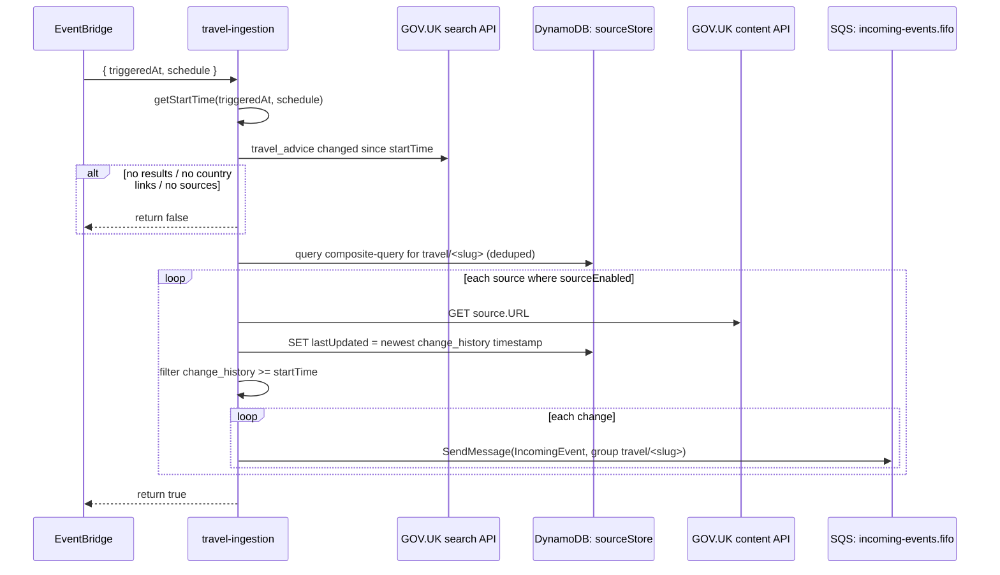

## Travel Ingestion

Polls GOV.UK for foreign travel advice that has changed within the schedule's look-back window and queues one event per change note for each enabled country.

- **Function:** `<env>-eventsaggregator-travel-ingestion`
- **Trigger:** EventBridge rules `HOURLYTravelSchedule`, `DAILYTravelSchedule`, `WEEKLYTravelSchedule`
- **Timeout / memory:** 10 s / 128 MB
- **Retries:** see [Architecture: failure semantics](/docs/architecture.md#failure-semantics)

### Sample event

```json
{
  "triggeredAt": "2026-10-16T09:00:00Z",
  "schedule": "hourly",
  "source": "aws.events"
}
```

Add `"debugSuffix": " [test]"` to append a marker to every queued note. This is for non-production testing only.

### Infrastructure

- **GOV.UK search API.** Lists `travel_advice` documents with `public_timestamp` at or after the window start.
- **GOV.UK content API.** Called once per matching enabled source (`Source.URL`).
- **DynamoDB `sourceStore`.** Read via the `composite-query` GSI. Writes `lastUpdated`.
- **SQS `incoming-events.fifo`.** `SendMessage`, one message at a time, with `MessageGroupId` set to `travel/<slug>`.
- **Metrics:** `TravelAdviceResultsRetrieved`, `EventSourcesRetrieved`, `TravelEventsQueued`.

Window lengths: hourly = 1 hour, daily = 1 day, weekly = 7 days, counted back from `triggeredAt`. The overlapping windows are intentional. Duplicates are removed downstream (see [Architecture: idempotency](/docs/architecture.md#duplicate-protection)).

### Logic



### Failure behaviour

Any thrown error, whether from the GOV.UK APIs, DynamoDB or SQS, fails the whole run, and EventBridge retries it. Countries already queued before the failure are queued again on retry. That's harmless, because `eventProcessing` de-duplicates on `eventID`.

Runbook: [Travel Ingestion Stale](/docs/runbooks/travel-ingestion-stale.md).
